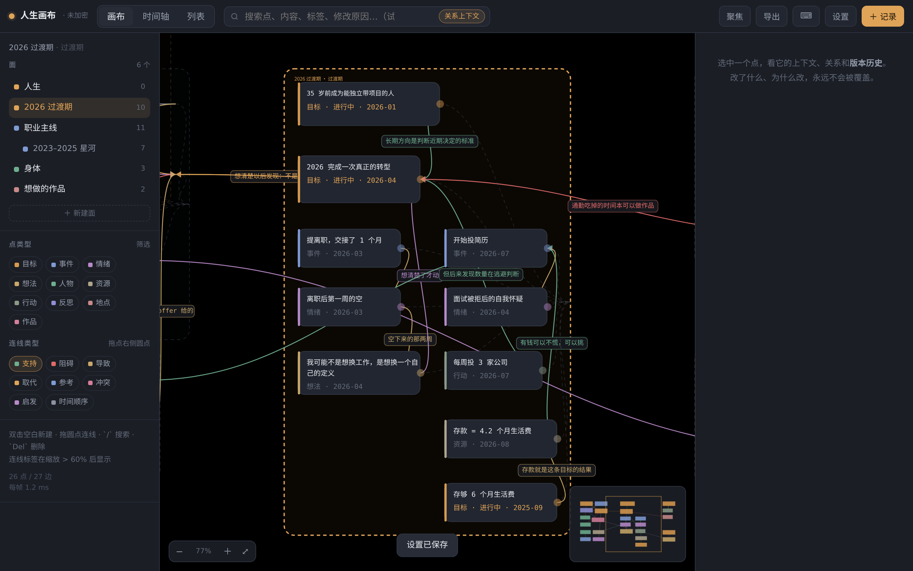
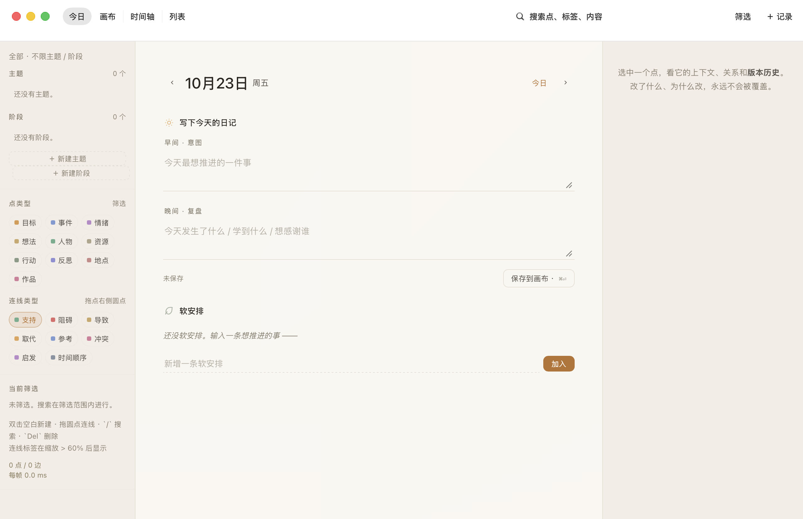
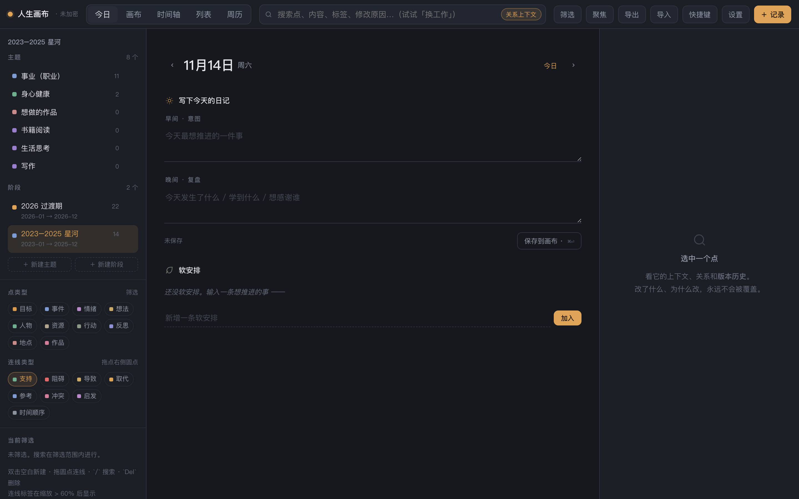
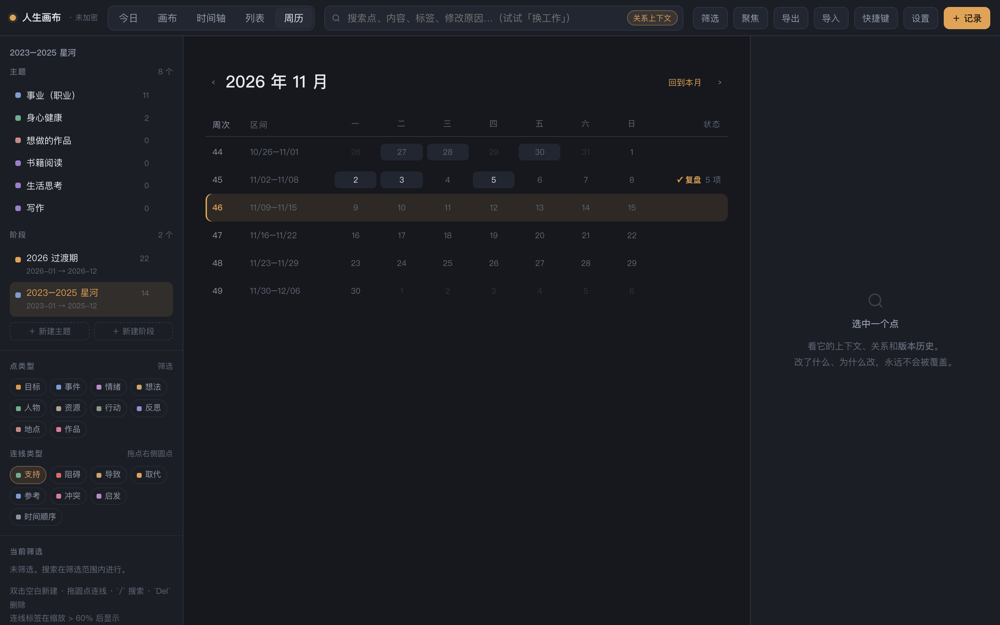

# Life Canvas

> Not a to-do list. A map of your life where you can **see the relations**.
>
> Local-first · ordered and searchable · edits never overwrite · no account, no server, no telemetry

**中文 README → [README.md](README.md)**



Goals, stages and ideas live on one infinite canvas, connected by **nine relations that
carry rules**, and read back through time. Ten node types, nine relations — every edge
has a name, a direction and a constraint.

---

## What it is

- **An infinite canvas** — zoom, pan, marquee-select, multi-select; it feels like any drawing tool
- **Nine relations with rules** — Belongs to / Supports / Blocks / Causes / Replaces /
  References / Conflicts / Inspires / Time order. Legal targets **light up while you drag**,
  so an invalid link never happens in the first place
- **Three dimensions** — themes (long arcs, nestable), stages (time bands with a start and end
  month), and time. Anything whose time falls inside a stage joins it automatically
- **Five views, one dataset** — canvas / timeline / list / today / week calendar
- **Version history** — every content change is snapshotted and asks *why*; mark milestones
  yourself, and get back when you were wrong
- **Encrypted by default** — AES-GCM-256 per record; the key derived from your master password
  lives in memory only
- **Export** — JSON (full fidelity) / Markdown (for humans) / JSON Canvas (Obsidian opens it)

## What it is not

- Not a task-assignment tool — it answers one question: **where does this sit in my life?**
- Not a cloud service — no network, no sync, no upload. Moving devices means exporting and
  importing by hand
- Not a "write anything" memo app — ten node types and nine relations mean the data has
  **structure**

---

## Run it

### Web

```bash
npm install
npm run dev        # http://127.0.0.1:5178
```

The first launch asks you to set a master password (encryption is on by default; you can turn
it off in Settings).

```bash
npm run build      # typecheck + static output into dist/
```

`dist/` is a **pure static bundle**: zero runtime dependencies, no network requests, system
fonts only. Open it locally or drop it into any shell (Tauri / Electron / WKWebView).

### macOS

A native window shell (WKWebView) around the same front end. No business logic is duplicated
on the native side.

```bash
./macos/build.sh                  # → macos/.build/LifeCanvas.app (dev build, ad-hoc signed)
open macos/.build/LifeCanvas.app
```

Needs macOS 13+ and the Xcode command line tools.



For a signed universal build:

```bash
./macos/release.sh                # → ~/Desktop/人生画布.app
```

> `release.sh` signs with the **Apple Development certificate in your own keychain**; both the
> signing identity and the bundle id can be overridden with environment variables (see the
> script header). For local development `build.sh` is enough — it needs no certificate.

---

## About this open-source release

### What's in the repo, and what isn't

This is the complete source of the **desktop app** (a native macOS shell around the web
front end). You can build it and run it yourself.

A few things are deliberately **not** in this repo:

| Not included | Why |
|---|---|
| The iOS line | Only the desktop app is open-sourced |
| Store metadata (screenshots / promo art / ASO copy) | Release artifacts travel with the release, not with the code |
| Internal docs / business plans | Irrelevant to running the code |
| The icon's AI source art and generation prompts | See [`macos/Icon/README.md`](macos/Icon/README.md); the icon has a fully reproducible vector route |

> The file boundary of the public repo is **explicit** and can be checked line by line:
> `git ls-files`. `.export-manifest.txt` in this repo is a snapshot of the same list.

### The bundle id is a placeholder

Both `macos/LifeCanvas/Info.plist` and `macos/release.sh` use `com.example.lifecanvas` —
`example.com` is a reserved domain, so it can't collide with a real developer.

To use your own, change **both** places:

```bash
# 1) CFBundleIdentifier in macos/LifeCanvas/Info.plist
# 2) the BUNDLE_ID default in macos/release.sh
```

To try a different id without editing any file:

```bash
LIFE_CANVAS_BUNDLE_ID=com.yourcompany.lifecanvas ./macos/release.sh
```

> ⚠️ The bundle id **is** the sandbox container name — changing it means a new container,
> which means existing users lose access to their data. Don't change it once you've shipped,
> unless you're prepared to migrate people over.

### Your name ends up in the signature

`release.sh` signs with the certificate in **your own keychain**, and the resulting
.app embeds the signer's name and Team ID — that's how code signing works, and it's
what Gatekeeper's "Show Details" displays. **The private key never leaves the
keychain**: the repo contains no certificate files at all (no .p12, no .pem, no
provisioning profile) — the certificate is read from the keychain at build time with
`security find-identity`.

To keep your name out of the artifact, use `build.sh` (ad-hoc signed, no identity at
all), or run `release.sh` on a machine with no development certificate (it falls back
to ad-hoc on its own).

### Changing the icon needs Pillow

Building the app needs **neither** Python nor Pillow. Only the icon scripts under
[`macos/Icon/`](macos/Icon/README.md) do:

```bash
pip3 install -r macos/Icon/requirements.txt
```

---

## The five views

| View | The question it answers | Screenshot |
|---|---|---|
| **Canvas** | What does the structure look like? | [canvas](docs/images/canvas.png) |
| **Timeline** | What came first, what replaced what? | [timeline](docs/images/timeline.png) |
| **List** | The inventory (searchable, filterable) | [list](docs/images/list.png) |
| **Today** | What is on for today (morning intent + evening review + soft plans) | [today](docs/images/today.png) |
| **Week calendar** | Week by week; click into any week for its own canvas | [week](docs/images/week-calendar.png) |

**Today** lays a single day out in three slots: one line of morning intent, one line of
evening review, and any number of "soft plans" alongside.



**Week calendar** is one row per week — click into it for that week's own canvas. Weeks
you've already reviewed are marked.



The **week canvas** can pull in **copies** of that week's records from the main canvas — the
originals stay put, the copies are yours to change, and each copy remembers where it came
from. Pick a few nodes and lay them out as a 1080×1440 vertical PNG (a review card).

---

## Three dimensions

| Dimension | What it is | Example |
|---|---|---|
| **Theme** (LifeTheme) | A long arc of your life, **nestable** | Work › Career › Engineer |
| **Stage** (LifeStage) | A time band with a start and end month | `2023-2025 星河`, `2026 transition` |
| **Time** | An attribute, not a separate coordinate system | a node's `time` field |

Nodes belong to themes and stages explicitly via `themeIds` / `stageIds`; a node whose `time`
falls inside a stage joins it automatically. Selecting both dimensions gives you the
intersection.

---

## The privacy boundary (you can check it)

- **No account, no server, no ads, no telemetry.** Not a promise — a fact you can grep for:
  ```bash
  grep -rnE "fetch\(|XMLHttpRequest|WebSocket|URLSession" src/ macos/
  ```
  There is exactly **one** outbound request in the whole repo: if a node carries an **image
  URL** (URL covers are not persisted), generating a review card fetches that image to draw it
  into the PNG. The address is one you supplied, and it only happens when you click generate.

  > That grep matches **two** places: the one above, plus a `fetch` in
  > `macos/SmokeTest/main.swift` — that one is a smoke-test probe hitting the app's own
  > `app://local` scheme (checking the custom scheme really serves the worker file).
  > It never leaves the machine.
- Your data stays on this machine, encrypted per record (AES-GCM-256, PBKDF2-SHA256 with
  600,000 rounds). Forgetting the master password means the data is gone — no back door, no
  recovery flow.
- Encryption protects against losing the device, someone digging through the disk, someone
  opening your computer. It does not protect against keyloggers while unlocked, malicious
  extensions, or root reading memory.

---

## The data format is a public contract

Nodes, relations, themes, stages, version history — and the JSON / Markdown / JSON Canvas
exports — are things **other people also rely on**. Changing them changes other people's data.

- Field-level reference → [`docs/DATA-FORMAT.md`](docs/DATA-FORMAT.md)
- Why it looks like this → [`docs/ARCHITECTURE.md`](docs/ARCHITECTURE.md)
- The native shell's traps → [`docs/macos-shell.md`](docs/macos-shell.md)

Please open an issue before changing the data format.

---

## Development

```bash
npm install
npm run typecheck   # tsc --noEmit
npm test            # 366 unit tests
npm run lint        # eslint
npm run i18n        # string table health check
npm run i18n:native # native shell vs web — shared keys must match verbatim
npm run build       # build
```

The three gates every push must pass (CI runs the same):

```bash
npm run typecheck && npm test && npm run i18n
```

Helper scripts:

```bash
node e2e.cjs        # end-to-end regression (needs playwright)
node stress.cjs     # performance stress test (needs `npm run dev` running)
npm run seed        # generate a 10k-node library
```

Screenshots (no screen-recording permission required):

```bash
# web: drive Chromium over CDP
npm run build && npx vite preview --port 4173 &
node scripts/uishot.mjs http://127.0.0.1:4173/ shots/ui

# macOS: render the native window offscreen to PNG
macos/.build/LifeCanvas.app/Contents/MacOS/LifeCanvas --shot "$PWD/shots/native" --shot-size 1280x840
```

The native side also has an 80-assertion self-test that needs no human eyes:

```bash
macos/.build/LifeCanvas.app/Contents/MacOS/LifeCanvas --selftest
```

> ⚠️ The self-test runs against your **real container** — it temporarily changes settings and
> touches your library, then restores everything. Don't run it on someone else's machine.

---

## Contributing

PRs are welcome. The short version:

- **Keep the main line restrained** — this is open source to make the tool **usable by more
  people**, not to pile on features. Open an issue before adding one
- **Discuss data-format changes first** — see above
- **No new runtime dependencies** — a zero-dependency static bundle is part of the product's
  promise, and part of the privacy promise
- **No background network requests** — there is exactly one today (a review card fetching an
  image URL you supplied)

See [`CONTRIBUTING.md`](CONTRIBUTING.md).

---

## License

[MIT](LICENSE) © 2026 人生画布 (Life Canvas) contributors

Want to wrap it in your own shell, change the model, or connect it to your own diary app?
Go ahead.
