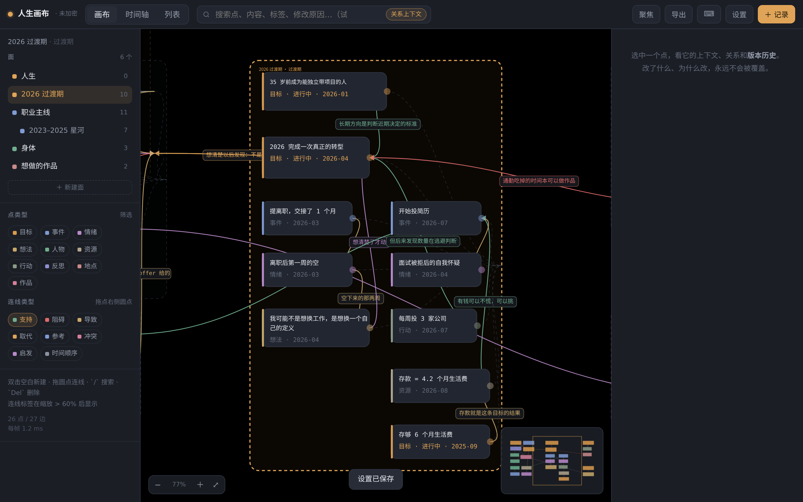
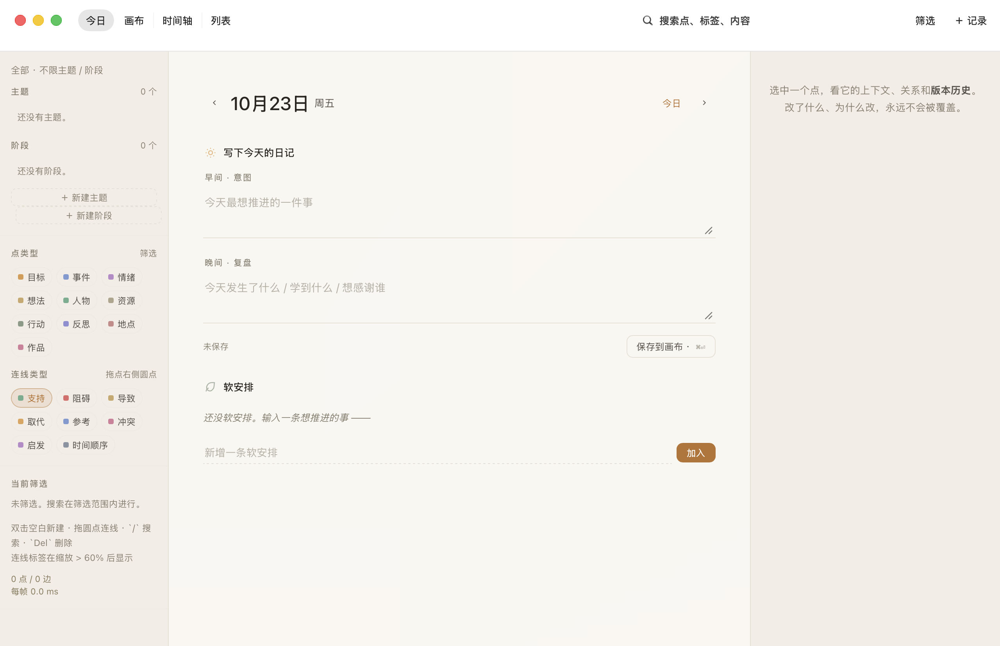

# 人生画布 · Life Canvas

> 不是待办清单，是一张**能看见关系**的人生地图。
>
> 本地优先 · 有序可搜索 · 修改不覆盖 · 无账号无服务器无遥测

**English README → [README.en.md](README.en.md)**



目标、阶段、想法放在同一张无限画布上，用**九种带规则的关系**连起来，再按时间回看。
十个点类型，九种关系，每一条都有名字、方向和约束。

---

## 它是什么

- **无限画布** —— 缩放、平移、框选、多选，跟画图工具一样顺手
- **九种带规则的关系** —— 属于 / 支持 / 阻碍 / 导致 / 取代 / 参考 / 冲突 / 启发 / 时间顺序。
  拖动时**合法目标会高亮**，拉错的可能性从一开始就没有
- **三个维度** —— 主题（长期领域，可嵌套）、阶段（带起止月份的时段）、时间。
  落在阶段区间里的点自动归属，不用手动挂
- **五个视图，一份数据** —— 画布 / 时间轴 / 列表 / 今日 / 周历
- **版本历史** —— 内容改动自动留快照，**必须填原因**；手动里程碑可以标记，改错了能回去
- **默认加密** —— 每条记录独立 AES-GCM-256，主密码派生的密钥只在内存里
- **导出** —— JSON（完整保真）/ Markdown（给人看）/ JSON Canvas（Obsidian 能直接打开）

## 它不是什么

- 不是任务分配工具 —— 它只回答一件事：**这件事在我人生的哪个位置**
- 不是云服务 —— 不联网、不同步、不上传。换设备自己导出再导入
- 不是"什么都能记"的备忘录 —— 十个点类型、九种关系，是**有结构**的

---

## 跑起来

### 网页版

```bash
npm install
npm run dev        # http://127.0.0.1:5178
```

首次打开会要求设置主密码（默认开启加密，可在「设置」里关）。

```bash
npm run build      # 类型检查 + 产出静态文件到 dist/
```

`dist/` 是**纯静态产物**：零外部依赖、不发任何网络请求、字体全走系统栈。
可以直接本地打开，也可以套进任何壳（Tauri / Electron / WKWebView）。

### macOS 桌面版

原生窗口壳（WKWebView）+ 前端，业务逻辑一行都不在原生侧重复实现。

```bash
./macos/build.sh                  # → macos/.build/LifeCanvas.app（开发用，ad-hoc 签名）
open macos/.build/LifeCanvas.app
```

需要 macOS 13+ 和 Xcode 命令行工具。



出正式版（universal 二进制 + 签名）：

```bash
./macos/release.sh                # → ~/Desktop/人生画布.app
```

> `release.sh` 默认用**本机钥匙串**里的 Apple Development 证书，签名身份和
> bundle id 都可以用环境变量覆盖（见脚本头部注释）。贡献者本地开发用
> `build.sh` 就够了 —— 它不需要任何证书。

---

## 五个视图

| 视图 | 回答的问题 | 截图 |
|---|---|---|
| **画布** | 结构长什么样 | [canvas](docs/images/canvas.png) |
| **时间轴** | 先后与取代链 | [timeline](docs/images/timeline.png) |
| **列表** | 清单（可搜索、可筛） | [list](docs/images/list.png) |
| **今日** | 当天要做什么（早间意图 + 晚间复盘 + 软安排） | |
| **周历** | 一周一周地回看；点进任意一周是一块独立画布 | |

**周画布**可以把主画布这一周的记录**复制**进来 —— 原件留在主画布，副本可以随便改，
副本记得来源、能一键跳回原件。挑几个点还能排成 1080×1440 的竖版 PNG（复盘卡片）。

---

## 三个维度

| 维度 | 是什么 | 例子 |
|---|---|---|
| **主题**（LifeTheme） | 长期关注的领域，**可嵌套** | 事业 › 职业 › 工程师 |
| **阶段**（LifeStage） | 带起止月份的时段 | `2023-2025 星河`、`2026 过渡期` |
| **时间** | 一个属性，不是一套坐标系 | 点上的 `time` 字段 |

节点通过 `themeIds` / `stageIds` 显式归属；`time` 落在阶段区间内的**自动归属**。
两边同时勾 = 交集。

---

## 隐私边界（可以逐行核对）

- **没有账号、没有服务器、没有广告、不做遥测。** 这不是承诺，是可以核对的：
  ```bash
  grep -rnE "fetch\(|XMLHttpRequest|WebSocket|URLSession" src/ macos/
  ```
  全仓**只有一处对外请求**：节点上贴了**图片 URL**（贴 URL 的封面图不持久）时，
  生成复盘卡片会把那张图拉下来画进 PNG。地址是你自己给的，只在你点生成时发生。
  > 这条命令会命中**两处**：上面那处，以及 `macos/SmokeTest/main.swift` 里的一次
  > `fetch` —— 那是冒烟测试探针，打的是 App 自己的 `app://local` scheme
  > （验证自定义 scheme 确实把 worker 文件发出去了），**不出网**。
- 你的数据只在这台机器上，用主密码派生的密钥**逐条加密**（AES-GCM-256，
  PBKDF2-SHA256 60 万次迭代）。忘了主密码 = 数据没了，没有后门，也没有找回流程。
- 加密防的是：设备丢失、磁盘被翻、别人打开你的电脑。
  防不了：已解锁状态下的键盘记录、恶意插件、系统最高权限下的内存读取。

---

## 数据格式是对外契约

节点 / 关系 / 主题 / 阶段 / 版本历史这些结构，以及 JSON / Markdown / JSON Canvas
三种导出格式，是**别人也在用**的东西 —— 改它们等于改别人的数据。

- 字段级的完整说明 → [`docs/DATA-FORMAT.md`](docs/DATA-FORMAT.md)
- 为什么长成这样 → [`docs/ARCHITECTURE.md`](docs/ARCHITECTURE.md)
- 原生壳的坑 → [`docs/macos-shell.md`](docs/macos-shell.md)

改数据格式请先开 issue 讨论。

---

## 开发

```bash
npm install
npm run typecheck   # tsc --noEmit
npm test            # 366 条单元测试
npm run lint        # eslint
npm run i18n        # 文案表体检：漏翻 / 占位符 / 中文键残留
npm run i18n:native # 核对原生壳与 web 侧共用的文案键逐字一致
npm run build       # 构建
```

提交前必须过的三道关（CI 也跑这几条）：

```bash
npm run typecheck && npm test && npm run i18n
```

其它辅助脚本：

```bash
node e2e.cjs        # 端到端回归（需要 playwright：npm i -D playwright && npx playwright install chromium）
node stress.cjs     # 性能压测（需要 npm run dev 起着）
npm run seed        # 生成 1 万点的压测库
```

截图工具（不依赖「屏幕录制」权限）：

```bash
# web 版：CDP 驱动 Chromium，逐个视图截图
npm run build && npx vite preview --port 4173 &
node scripts/uishot.mjs http://127.0.0.1:4173/ shots/ui

# macOS 版：把原生窗口离屏渲染成 PNG（含标题栏工具栏）
macos/.build/LifeCanvas.app/Contents/MacOS/LifeCanvas --shot "$PWD/shots/native" --shot-size 1280x840
```

原生侧还有一套 80 条断言的自测（不需要人眼）：

```bash
macos/.build/LifeCanvas.app/Contents/MacOS/LifeCanvas --selftest
```

> ⚠️ 自测跑在**真实容器**上，会临时改设置、动到自己的库，跑完自动还原。
> 别在别人的机器上乱跑。

---

## 参与

欢迎 PR。几条约定：

- **主线保持克制** —— 这个项目开源是为了**让更多人用起来**，不是用来堆功能。
  「再加一个功能」类需求请先开 issue 讨论，别直接 PR
- **数据格式动之前先讨论** —— 见上面「数据格式是对外契约」
- **不要引入运行时依赖** —— `dist/` 零外部依赖是产品的卖点，也是隐私承诺的一部分
- **不要引入后台网络请求** —— 现在全仓只有一处（复盘卡片拉用户自己贴的图片 URL）

详见 [`CONTRIBUTING.md`](CONTRIBUTING.md)。

---

## 授权

[MIT](LICENSE) © 2026 人生画布 (Life Canvas) contributors

想自己包一个壳、改主题模型、接自己的日记 App —— 都欢迎。
